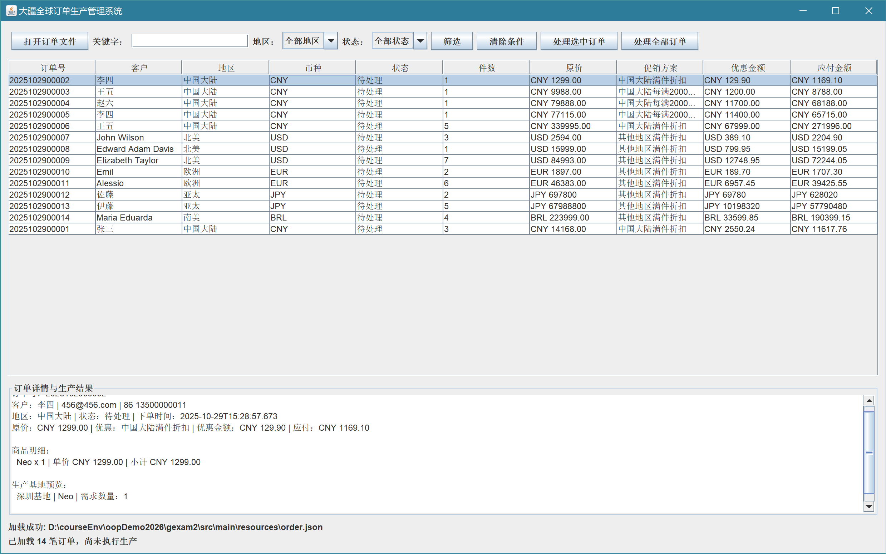

# 机试二：大疆全球订单生产管理系统

## 一、考试信息

- **建议时长：** 240 分钟
- **开发语言：** Java
- **允许使用：** IDE、Java 官方文档、AI 编程辅助工具
- **提交内容：** 完整可运行项目、自动化测试、设计说明、AI 使用说明

本题以“大疆全球订单与生产调度系统”为业务背景，实现完整的订单处理应用，GUI桌面图形交互、函数式编程和 Stream API 。允许借助 AI，但必须能够解释架构、关键代码和测试结果；不能以“AI 生成”为由提交无法运行或无法解释的实现。

## 二、业务背景与基础数据

大疆在全球设有多个生产基地。系统从 `order.json` 加载客户订单，依据订单地区和商品类型将产品分配给相应基地生产，并计算双 11 活动下的最优优惠方案。

订单数据以项目配套的 `order.json` 为基础。订单包含订单号、客户信息、地区、币种、状态、下单时间、订单总金额和商品明细；每条商品明细包含产品型号、购买数量、单价和明细金额。产品的型号及参数可参照项目提供的 `DJIProductDemo` 和基础工程中的类定义。**以实际 JSON 中的产品型号为准**，不要自行将名称近似的型号视为同一产品。

产品类别如下：

| 产品类别 | 型号示例 |
|---|---|
| 消费级 | Mini 4、Neo、Air 3、Avata 2 |
| 行业级 | Inspire 3、Matrice 400、Mavic 4 PRO |
| 农业及载重级 | T100、T70 |

### 生产基地职责

| 生产地区 | 产品类别 | 生产基地 |
|---|---|---|
| 中国大陆 | 消费级 | 深圳基地 |
| 中国大陆 | 行业级 | 东莞基地 |
| 全球所有地区 | 农业及载重级 | 顺德工厂 |
| 亚太地区 | 消费级、行业级 | 日本名古屋工厂 |
| 欧洲地区 | 消费级 | 荷兰阿姆斯特丹基地 |
| 欧洲地区 | 行业级 | 德国斯图加特基地 |
| 北美、南美地区 | 消费级、行业级 | 美国加州弗里蒙特工厂 |

未列出的地区与产品类别组合没有可用工厂。系统必须明确报告该订单明细无法路由，不得错误分配、返回 `null` 或静默跳过。

### 双 11 促销规则

优惠按订单商品原价总额计算，订单币种以 JSON 为准，不做币种换算。中国大陆的满减金额单位为人民币元。

| 适用地区 | 活动 | 优惠规则 |
|---|---|---|
| 中国大陆 | 满件折扣 | 整单商品总件数满 1 件 9 折、满 2 件 8.6 折、满 3 件 8.2 折、满 4 件及以上 8 折 |
| 中国大陆 | 满额立减 | 每满 2000 元减 300 元，不设档数上限 |
| 中国大陆以外 | 满件折扣 | 整单商品总件数满 1 件 9.5 折、满 2 件 9 折、满 3 件及以上 8.5 折 |

同一订单的折扣与满减不可叠加。对所在地区适用的方案分别计算应付金额，选择应付金额最低的方案；并列时依次优先选择“满额立减”“满件折扣”“无优惠”。若订单不满足任何活动门槛，则按原价结算。

## 三、总体目标

实现一个具有桌面图形界面的订单生产管理系统。用户可以加载订单文件、浏览和筛选订单、查看订单优惠及生产路由、执行生产模拟并查看汇总统计。业务逻辑必须与界面分离；同一套服务逻辑应既能被 GUI 调用，也能被自动化测试直接调用。

推荐采用分层结构，例如：

```text
UI（Swing 界面）
    ↓
应用服务（订单查询、促销计算、生产处理）
    ↓
领域模型（订单、商品、产品、基地、促销结果）
    ↓
文件读取 / 工厂路由 / 序列号等基础组件
```

允许采用 MVC、MVP 或其他职责清楚的结构；需在设计说明中说明选型。

## 四、必做任务

### 任务 1：领域模型与面向对象设计（10 分）

补全或设计必要领域类，至少覆盖订单、客户、订单明细、产品、产品类别、地区、币种、订单状态、生产基地、生产任务及促销计算结果。

要求：

- 使用枚举表示有限取值的地区、币种、订单状态和产品类别；
- 产品类型应有合理的抽象与继承设计，不以一组互不相关的字符串代表产品；
- 通过封装维护关键对象状态和不变量，不公开任意可写字段；
- 将文件解析、领域规则、生产调度、促销计算和图形界面职责分开；
- 避免将全部逻辑堆放在主控类、界面事件监听器或单个超长方法中。

### 任务 2：订单文件读取、校验和查询（10 分）

实现 JSON 文件读取，将内容转换为领域对象，并支持从命令行参数或 GUI 选择文件。

至少校验：

- 订单号非空且唯一；
- 客户、地区、币种、时间、状态等必需字段合法；
- 明细列表非空，型号有效，数量为正整数，单价非负；
- 明细金额等于单价乘数量，订单总金额等于所有明细金额之和。

金额或字段错误应报告可定位的信息（如订单编号、明细序号和具体原因）。需选择并说明错误处理策略：整份文件失败，或跳过无效订单并展示错误汇总。

### 任务 3：序列号单例与产品创建（10 分）

实现线程安全的单例 `SerialNumberGenerator`，为每个生产出的产品实例生成全球唯一的递增序列号：

```text
DJI-00000001
DJI-00000002
```

要求序号为 8 位；序号耗尽时显式报告错误，不得回绕或重复。外部调用者不得随意指定产品序列号。产品创建时应使用 `DJIProductDemo` 提供的产品参数。

### 任务 4：抽象工厂与生产路由（15 分）

按照**抽象工厂模式**实现业务描述中的七个生产基地。系统根据订单地区和产品类别选择工厂，并由工厂创建对应产品。

要求：

- 地区与产品类别的路由规则集中管理，不在多个业务模块重复实现；
- 各工厂只能创建职责范围内的产品；
- 对未定义的路由组合返回明确业务错误；
- 单元测试需覆盖职责表中的组合以及至少一个无效组合。

### 任务 5：促销策略与最优选择（15 分）

按照**策略模式**实现中国大陆满额立减、中国大陆满件折扣、其他地区满件折扣和无优惠策略，并完成最优方案选择。

要求：

- 所有金额与折扣计算使用 `BigDecimal`，禁止 `float`、`double` 及金额上的浮点运算；
- 按订单所有明细数量之和计算总件数；
- 满减按每满 2000 元计算档数；
- 不同地区只能参与其适用活动，不同活动不得叠加；
- 返回结构化结果，至少包含活动名称、优惠金额、应付金额；
- 统一比较候选方案，并实现题目定义的并列优先规则。

### 任务 6：图形交互界面（20 分）

使用 **Java Swing** 实现桌面 GUI（可使用项目既有 JavaFX 工程，但需保持同等功能且说明运行依赖）。界面至少包含：

1. **文件操作：** “打开订单文件”按钮、当前文件路径及加载成功/失败提示。
2. **订单列表：** 以表格展示订单号、客户、地区、币种、状态、商品件数、原价和应付金额。
3. **查询筛选：** 支持按订单号或客户名关键字查询，并按地区、订单状态筛选；筛选条件可组合，且支持清除条件。
4. **订单详情：** 选择一条订单后展示商品明细、各项数量和金额、活动选择结果及优惠金额。
5. **生产处理：** 提供“处理选中订单”或“处理全部有效订单”的操作，展示基地、产品型号、数量和产品序列号；无法路由或生产失败时展示错误信息。
6. **汇总面板：** 展示成功/失败订单数、优惠总额，以及各基地承接的产品数量。
7. **界面状态：** 文件未加载、无匹配结果、处理进行中和处理失败等状态都应有清晰反馈；长时间操作期间不得导致窗口无响应。

界面及交互要求：

- 使用 `JFileChooser` 选择 JSON 文件；
- 所有 Swing 组件更新必须在事件派发线程（EDT）执行；
- 文件读取或批量处理等可能耗时的任务不得阻塞 EDT，可使用 `SwingWorker` 或等价方案；
- 事件监听器只负责收集界面输入、调用应用服务并呈现结果，不直接实现促销或路由规则；
- 不得使用弹窗代替所有状态反馈；错误提示应说明如何定位或修正问题。

 示意图，非最终界面要求。界面布局、组件风格和交互方式可自行设计，但必须满足上述功能和状态反馈要求。

### 任务 7：函数式编程与 Stream API（15 分）

必须在订单查询、筛选、统计或汇总中实际使用 Java 函数式编程和 Stream API。仅为满足要求而写无意义的单行 Stream 不计分。

至少完成以下功能，并在设计说明中标出对应代码位置：

1. 使用 Stream 对订单进行多条件组合筛选，例如关键字、地区和状态；
2. 使用 `Collectors.groupingBy` 与 `Collectors` 统计各地区订单数，或各基地产品数量；
3. 使用 `map`、`flatMap`、`filter`、`sorted`、`reduce` 或 `collect` 中至少三种操作处理订单/商品数据；
4. 至少自定义一个有明确业务意义的函数式接口，或使用 `Predicate`、`Function`、`Comparator`、`Supplier` 等标准函数式接口完成可组合的查询/策略逻辑；
5. 使用方法引用或 Lambda 表达式实现排序、映射或回调中的至少一处；
6. 对订单明细扁平化（如多个订单商品明细）进行筛选或统计，结果与测试预期一致。

示例方向（只描述目标，不要求照抄实现）：统计各地区订单数、统计各产品型号总需求量、按应付金额降序排列订单、筛选指定客户的所有商品明细。

Stream 处理应保持可读性；避免在流操作中修改外部共享状态、执行 Swing 组件更新或隐藏异常。并行流不是必做要求，不应为使用并行流而牺牲正确性。

### 任务 8：自动化测试与设计说明（5 分）

提交可重复运行的自动化测试，至少覆盖：

- 正常 JSON 读取、金额校验失败和重复订单号；
- 生产基地路由正确及无可用工厂的情况；
- 折扣门槛、满减门槛、优惠封顶和并列优先规则；
- 多条件 Stream 筛选与分组统计；
- 并发调用序列号生成器时不重复；
- 关键业务服务不依赖 Swing 界面，能独立测试。

另附简短设计说明，列出主要类及职责、使用的设计模式、函数式接口/Stream 的业务用途、GUI 线程处理方案，以及至少一个经测试发现并修正的问题。

## 五、界面验收场景

教师或助教可按以下流程验收：

1. 启动程序，打开配套 `order.json`；
2. 在订单表格中检查订单信息及优惠后金额；
3. 输入客户名关键字并选择地区，确认筛选结果同时满足全部条件；
4. 选中订单，查看商品明细、促销计算结果和生产基地；
5. 执行生产，确认生成产品序列号及生产任务；
6. 检查成功/失败订单数、优惠总额和基地统计；
7. 加载含有错误字段或错误金额的文件，确认界面给出明确反馈且仍可继续操作。

## 六、实现与提交约束

- 使用 Java 标准桌面 GUI；默认按 Java Swing 验收。
- JSON 库可使用项目已有依赖；新增依赖需在设计说明中解释。
- 可以采用命令行参数指定默认订单文件；未指定时提供合理默认路径或提示用户选择文件。
- 金额以订单原币种呈现，不进行汇率换算；满减活动仅适用于中国大陆人民币订单。
- 不得吞掉异常、以 `null` 表示业务失败，或用默认值掩盖无效输入。
- Stream 统计和界面展示数据应由业务服务或查询服务提供，不应将规则复制到 GUI。
- AI 生成的代码、测试及建议均由提交者负责验证；不得提交含未解释的占位逻辑或未完成方法。

提交内容：

1. 完整、可运行的 Java 项目源代码；
2. 自动化测试及运行说明；
3. README 或设计说明；
4. AI 使用说明：使用了哪些工具、用于哪些环节，以及如何验证或修改其输出。

## 七、评分细则

| 评分项 | 分值 | 主要评价内容 |
|---|---:|---|
| 领域模型与面向对象设计 | 10 | 封装、抽象、职责分配和对象不变量 |
| JSON 读取与校验 | 10 | 数据映射、金额一致性、可定位错误 |
| 序列号与产品创建 | 10 | 单例、并发安全、格式与边界处理 |
| 抽象工厂与基地路由 | 15 | 七个基地职责正确、路由集中、错误明确 |
| 策略模式与促销计算 | 15 | 活动适用性、最优选择、BigDecimal 正确性 |
| Swing 图形界面 | 20 | 功能完整、交互清晰、EDT 与耗时任务处理正确 |
| 函数式编程与 Stream API | 15 | 实际业务应用、聚合筛选正确、代码清晰 |
| 测试、设计说明与 AI 使用说明 | 5 | 关键边界有测试，能解释设计与验证过程 |

**评分原则：** 能启动界面只是基础要求。重点考察业务规则正确性、面向对象设计质量、GUI 与业务逻辑解耦、Stream 运算的实际价值，以及提交者能否解释和验证 AI 辅助生成的代码。不能运行的项目将影响相关功能项评分；核心逻辑若只写在界面回调中，GUI 与设计质量项均不得满分。
