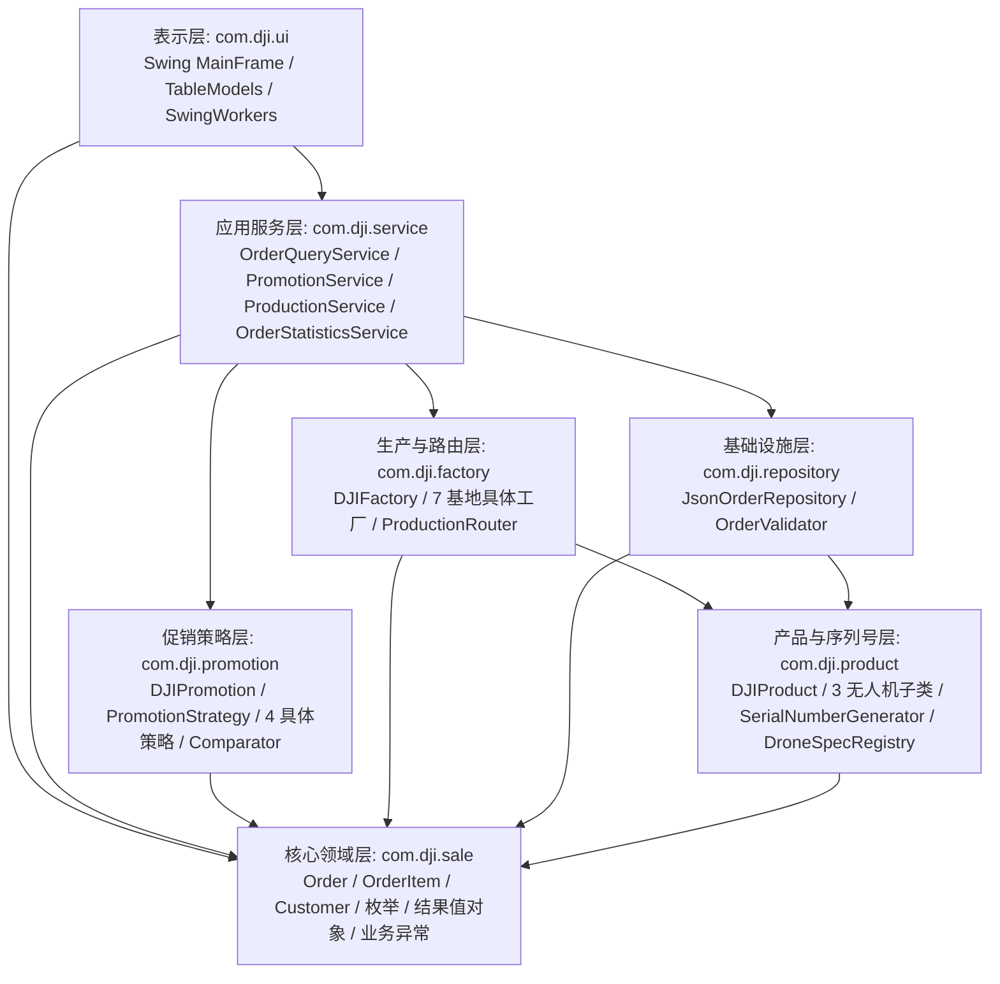

# ARCHITECTURE_BLUEPRINT｜核心架构蓝图

> **版本**：v1.0（Zed 初始架构定稿）
> **状态**：已基于 ZCode 阶段 0 真实勘察报告完成设计；待用户审阅关键业务裁决项（见 `docs/DECISIONS.md`）后作为 ZCode 阶段 2–7 的开发基线。
> **事实依据**：原版《G班机试2.md》、真实 `src/main/resources/order.json`（14 笔订单）、`sysgui.png`（14 笔促销期望值）、既有 7 个源码文件（`DJIProduct`、3 个无人机子类、`DJIFactory`、`DJIPromotion`、`DJIProductDemo`）。

---

## 一、架构分层与模块依赖

采用轻量、职责清晰的 **四层六包架构**（不引入任何超纲框架或分布式组件）：



### 依赖硬约束
1. **单向依赖**：`com.dji.sale`、`com.dji.product`、`com.dji.factory`、`com.dji.promotion`、`com.dji.repository`、`com.dji.service` **严禁导入 `javax.swing.*` 或 `java.awt.*`**，保证全部核心服务在无头（Headless）JUnit 环境中直接测试。
2. **兼容既有教师代码**：
   - `com.dji.promotion.DJIPromotion` 已写死 `import com.dji.sale.Order;`，因此核心订单领域类必须放在 `com.dji.sale` 包下，无需改动 `DJIPromotion.java`。
   - `com.dji.product.DJIProductDemo` 已写死 `SerialNumberGenerator.getInstance().nextSerialNumber()`，因此 `SerialNumberGenerator` 必须放在 `com.dji.product` 包下并提供完全一致的签名。

---

## 二、核心领域模型与不变量（`com.dji.sale`）

### 2.1 枚举设计（基于真实 JSON 与任务书映射）

| 枚举类 | 枚举常量与属性 | 真实数据 / 业务映射依据 |
|---|---|---|
| `Region` | `CHINA_MAINLAND("中国大陆")`, `NORTH_AMERICA("北美")`, `EUROPE("欧洲")`, `ASIA("亚太")`, `SOUTH_AMERICA("南美")` | **基于真实 JSON**：JSON 原文为 `ASIA`，对应任务书“亚太地区”与 `sysgui.png`“亚太”。提供 `fromCode(String)` 严格解析，未知值抛 `OrderValidationException`。 |
| `Currency` | `CNY("人民币")`, `USD("美元")`, `EUR("欧元")`, `JPY("日元")`, `BRL("巴西雷亚尔")` | **基于真实 JSON**：5 种币种原样保留，禁止任何汇率换算逻辑。提供 `formatAmount(BigDecimal)` 输出如 `CNY 14168.00`。 |
| `ProductCategory` | `CONSUMER("消费级无人机")`, `ENTERPRISE("行业级无人机")`, `AGRICULTURAL("农业级无人机")` | 对齐 `DJIProduct#getProductCategory()` 返回的字符串与 `DJIFactory` 三组型号常量。 |
| `OrderStatus` | `PENDING("待处理")`, `PROCESSED("已生产")`, `FAILED("处理失败")` | **部分待定**：JSON 中 14 笔全为 `PENDING`；`PROCESSED`/`FAILED` 用于支持 GUI 生产状态更新（见 D-009）。 |
| `ProductionBase` | `SHENZHEN("深圳基地")`, `DONGGUAN("东莞基地")`, `SHUNDE("顺德工厂")`, `NAGOYA("日本名古屋工厂")`, `AMSTERDAM("荷兰阿姆斯特丹基地")`, `STUTTGART("德国斯图加特基地")`, `FREMONT("美国加州弗里蒙特工厂")` | **基于原版任务书**：严格对应七个生产基地名称。 |

### 2.2 领域实体与值对象不变量

```java
package com.dji.sale;

// 1. 客户值对象（处理 U+200C 零宽字符陷阱）
public final class Customer {
    private final String rawName;        // 保留 JSON 原始字符串用于审计
    private final String normalizedName; // 剥离 \p{Cf}（含 U+200C）并 trim 后的名称，用于展示、查询与分组
    private final String email;
    private final String phone;
    // 不变量：normalizedName、email、phone 均非空（!isBlank）
}

// 2. 订单明细值对象
public final class OrderItem {
    private final int itemIndex;              // 明细在订单中的 1-based 序号（用于错误定位）
    private final String productType;         // 精确型号，如 "Mini 4 PRO"
    private final ProductCategory category;   // 由 DroneSpecRegistry 解析获得
    private final int quantity;               // > 0
    private final BigDecimal unitPrice;       // >= 0, scale=2
    private final BigDecimal totalAmount;     // 必须满足 unitPrice.multiply(BigDecimal.valueOf(quantity)).compareTo(totalAmount) == 0
}

// 3. 订单聚合根（兼容 DJIPromotion 接口签名）
public final class Order {
    private final String orderId;
    private final Customer customer;
    private final Region region;
    private final Currency currency;
    private OrderStatus status;
    private final LocalDateTime orderDate;    // 解析自 "yyyy-MM-dd HH:mm:ss.SSS"
    private final BigDecimal totalAmount;     // 必须等于 Σ items.totalAmount
    private final List<OrderItem> items;      // 非空不可变列表 List.copyOf

    public int getTotalQuantity();            // Stream 求和所有明细 quantity
    public BigDecimal getOriginalAmount();    // 返回 totalAmount.setScale(2, RoundingMode.HALF_UP)
}
```

---

## 三、真实 JSON 映射与校验机制（`com.dji.repository`）

### 3.1 字段映射与已知数据陷阱处理
- **顶层结构**：使用 `fastjson2`（`JSON.parseArray(jsonString, JSONObject.class)`）逐元素解析，以便在某笔订单字段损坏时仍能精准报告该笔订单的数组下标与 `orderId`。
- **型号精确匹配**：仅接受 `DroneSpecRegistry` 注册的 9 种精确拼写（`Mini 4 PRO`, `Neo`, `Air 3S`, `Avata 2`, `Inspire 3`, `Matrice 400`, `Mavic 4 PRO`, `T100`, `T70`）。若输入 `Mini 4` 或 `Air 3`，必须报“未知或无效产品型号”。
- **零宽字符清洗**：真实 `order.json` 中订单 `2025102900009` 客户名为 `\u200cElizabeth Taylor`、订单 `2025102900010` 为 `Emil\u200c`。`Customer` 构造时通过正则 `rawName.replaceAll("\\p{Cf}", "").trim()` 生成 `normalizedName`，使关键字检索 `Elizabeth` 或 `Emil` 及界面展示完全正常。
- **金额算术一致性校验**：
  - 明细级：`unitPrice.multiply(BigDecimal.valueOf(quantity)).compareTo(itemTotalAmount) == 0`
  - 订单级：`items.stream().map(OrderItem::getTotalAmount).reduce(BigDecimal.ZERO, BigDecimal::add).compareTo(orderTotalAmount) == 0`
- **订单号唯一性**：使用 `Set<String> seenOrderIds` 跟踪已加载订单号，重复 `orderId` 记入 `OrderValidationError`。

### 3.2 错误定位结构与失败策略（推荐单笔跳过 + 汇总报告）
```java
public record OrderValidationError(
    int recordIndex,       // JSON 数组序号 (1-based)
    String orderId,        // 若缺失则为 "<未知订单号>"
    Integer itemIndex,     // 明细序号 (1-based，订单级错误为 null)
    String fieldName,      // 错误字段名
    String message         // 可定位的中文错误原因
) {}

public record OrderLoadResult(
    Path sourceFile,
    List<Order> validOrders,
    List<OrderValidationError> errors
) {
    public boolean hasErrors() { return !errors.isEmpty(); }
}
```
- **策略说明**：当 JSON 顶层语法损坏（非合法 JSON 数组）时抛 `OrderFileParseException` 整份失败；当 JSON 语法合法但部分订单存在金额不符、重复单号或无效字段时，跳过无效订单并将其记入 `errors`，有效订单正常返回展示（同时支持严格模式整份拒绝，见 `DECISIONS.md` D-006）。

---

## 四、序列号生成与产品参数注册（`com.dji.product`）

### 4.1 线程安全序列号单例 `SerialNumberGenerator`
```java
package com.dji.product;

import java.util.concurrent.atomic.AtomicLong;

public final class SerialNumberGenerator {
    public static final long MAX_SERIAL = 99_999_999L;
    private static final SerialNumberGenerator INSTANCE = new SerialNumberGenerator();
    private final AtomicLong counter = new AtomicLong(0L);

    private SerialNumberGenerator() {}

    public static SerialNumberGenerator getInstance() {
        return INSTANCE;
    }

    public String nextSerialNumber() {
        long current = counter.incrementAndGet();
        if (current > MAX_SERIAL || current <= 0L) {
            counter.decrementAndGet(); // 保持耗尽状态不回绕
            throw new SerialNumberExhaustedException("序列号已耗尽，最大上限为 DJI-99999999");
        }
        return String.format("DJI-%08d", current);
    }

    // 仅限包内单元测试重置或设置边界值使用，生产代码禁止调用
    void resetForTest(long initialValue) {
        counter.set(initialValue);
    }
}
```
- **不变量**：线程安全（`AtomicLong` CAS 自增）、严格 8 位零填充（`DJI-00000001` ~ `DJI-99999999`）、耗尽时显式抛出 `SerialNumberExhaustedException`，绝不回绕或重复。

### 4.2 权威产品参数注册表 `DroneSpecRegistry`
严格依据 `DJIProductDemo.java` 真实构造参数（零改动复刻）：

| 型号 (`productType`) | 枚举类别 | 目标子类与 `DJIProductDemo` 精确构造参数 |
|---|---|---|
| `Mini 4 PRO` | `CONSUMER` | `new ConsumerDrone("Mini 4 PRO", sn, 249.0, "34分钟", "8K", true, "O4")` |
| `Neo` | `CONSUMER` | `new ConsumerDrone("Neo", sn, 135.0, "18分钟", "4K", false, "O4")` |
| `Air 3S` | `CONSUMER` | `new ConsumerDrone("Air 3S", sn, 724.0, "45分钟", "8K", true, "O4")` |
| `Avata 2` | `CONSUMER` | `new ConsumerDrone("Avata 2", sn, 377.0, "23分钟", "4K", false, "O4")` |
| `Inspire 3` | `ENTERPRISE` | `new EnterpriseDrone("Inspire 3", sn, 3995.0, "28分钟", "禅思  X5S", false, "影视", "IP45")` |
| `Matrice 400` | `ENTERPRISE` | `new EnterpriseDrone("Matrice 400", sn, 15800.0, "59分钟", "禅思H30", true, "应急抢险、电力巡检、测绘", "IP55")` |
| `Mavic 4 PRO` | `ENTERPRISE` | `new EnterpriseDrone("Mavic 4 PRO", sn, 1063.0, "51分钟", "4/3 CMOS 哈苏相机", false, "影视", "IP45")` |
| `T70` | `AGRICULTURAL` | `new AgriculturalDrone("T70", sn, 52000.0, "3.8小时", 50.0, 30.0, true, "有源相控阵雷达")` |
| `T100` | `AGRICULTURAL` | `new AgriculturalDrone("T100", sn, 73000.0, "3.8小时", 75.0, 40.0, true, "有源相控阵雷达")` |

> **封装保证**：业务侧只能通过具体基地工厂的 `orderDrone(String type)` / `buildDrone(String type)` 创建产品，工厂内部调用 `SerialNumberGenerator.getInstance().nextSerialNumber()`，外部调用者无法手工传入序列号。

---

## 五、抽象工厂模式与集中生产路由（`com.dji.factory`）

### 5.1 七个具体生产基地工厂（继承 `DJIFactory`）
每个基地工厂为一个独立的 `DJIFactory` 子类，严格限制其允许生产的 `Set<ProductCategory>`：

| 工厂子类 | 对应 `ProductionBase` | 允许生产的 `ProductCategory` | 越权行为 |
|---|---|---|---|
| `ShenzhenFactory` | `SHENZHEN`（深圳基地） | 仅 `CONSUMER` | 传入非消费级型号抛 `ProductionRoutingException` |
| `DongguanFactory` | `DONGGUAN`（东莞基地） | 仅 `ENTERPRISE` | 传入非行业级型号抛 `ProductionRoutingException` |
| `ShundeFactory` | `SHUNDE`（顺德工厂） | 仅 `AGRICULTURAL` | 传入非农业级型号抛 `ProductionRoutingException` |
| `NagoyaFactory` | `NAGOYA`（日本名古屋工厂） | `CONSUMER`, `ENTERPRISE` | 传入农业级或未知型号抛 `ProductionRoutingException` |
| `AmsterdamFactory` | `AMSTERDAM`（荷兰阿姆斯特丹基地） | 仅 `CONSUMER` | 传入非消费级型号抛 `ProductionRoutingException` |
| `StuttgartFactory` | `STUTTGART`（德国斯图加特基地） | 仅 `ENTERPRISE` | 传入非行业级型号抛 `ProductionRoutingException` |
| `FremontFactory` | `FREMONT`（美国加州弗里蒙特工厂） | `CONSUMER`, `ENTERPRISE` | 传入农业级或未知型号抛 `ProductionRoutingException` |

### 5.2 集中路由器 `ProductionRouter`
路由逻辑**全局唯一**维护在 `ProductionRouter` 中，其他模块严禁自行编写 `if/switch(region)`：
```java
package com.dji.factory;

public final class ProductionRouter {
    public ProductionBase resolveBase(Region region, ProductCategory category) {
        if (region == null || category == null) {
            throw new ProductionRoutingException("地区或产品类别不能为空");
        }
        // 规则 1：全球所有地区农业及载重级 -> 顺德工厂
        if (category == ProductCategory.AGRICULTURAL) {
            return ProductionBase.SHUNDE;
        }
        // 规则 2：按地区 + 消费级/行业级路由
        return switch (region) {
            case CHINA_MAINLAND -> (category == ProductCategory.CONSUMER)
                    ? ProductionBase.SHENZHEN : ProductionBase.DONGGUAN;
            case ASIA -> ProductionBase.NAGOYA;
            case EUROPE -> (category == ProductCategory.CONSUMER)
                    ? ProductionBase.AMSTERDAM : ProductionBase.STUTTGART;
            case NORTH_AMERICA, SOUTH_AMERICA -> ProductionBase.FREMONT;
            default -> throw new ProductionRoutingException(
                    "未定义的生产路由组合: region=" + region + ", category=" + category);
        };
    }

    public DJIFactory resolveFactory(Region region, ProductCategory category);
}
```

### 5.3 无效路由组合的设计与测试说明
- 在当前 5 个已开通地区 × 3 个类别的笛卡尔积（15 种组合）中，因农业级全球归顺德，其余 5 地区对消费级和行业级均有基地承接。
- 为满足任务 4“对未定义的路由组合返回明确业务错误，单元测试覆盖至少一个无效组合”的要求：
  1. 若某具体基地工厂被请求生产非职责范围内的产品类别（如向 `ShenzhenFactory` 请求 `Inspire 3` 或 `T100`），立即抛出 `ProductionRoutingException`；
  2. 支持对未开通基地的地区/类别路由查询（如 `Region` 含未开通测试区或传入未绑定基地的组合）显式抛出 `ProductionRoutingException`（绝不返回 `null` 或静默跳过）。

### 5.4 14 笔真实订单各基地产量静态核验表（供测试与 GUI G6 对照）
经对 `order.json` 全部 14 笔订单、21 条商品明细逐笔统计，总产量为 **42 架**：
- **深圳基地**（大陆消费级）：`0001`(Mini 4 PRO×2 + Avata 2×1) + `0002`(Neo×1) + `0003`(Air 3S×1) = **5 架**
- **东莞基地**（大陆行业级）：`0004`(Inspire 3×1) + `0005`(Matrice 400×1) = **2 架**
- **顺德工厂**（全球农业级）：`0006`(T100×5) + `0009`(T70×6) + `0011`(T70×4) + `0013`(T100×4) + `0014`(T100×2) = **21 架**
- **日本名古屋工厂**（亚太消费+行业）：`0012`(Mini 4 PRO×1 + Neo×1) + `0013`(Inspire 3×1) = **3 架**
- **荷兰阿姆斯特丹基地**（欧洲消费级）：`0010`(Mini 4 PRO×1 + Air 3S×1) = **2 架**
- **德国斯图加特基地**（欧洲行业级）：`0011`(Inspire 3×1 + Mavic 4 PRO×1) = **2 架**
- **美国加州弗里蒙特工厂**（北美/南美消费+行业）：`0007`(Mini 4 PRO×1 + Avata 2×2) + `0008`(Inspire 3×1) + `0009`(Matrice 400×1) + `0014`(Air 3S×1 + Matrice 400×1) = **7 架**
- **总计**：5 + 2 + 21 + 3 + 2 + 2 + 7 = **42 架**。

---

## 六、BigDecimal 促销策略模式与最优比较器（`com.dji.promotion`）

### 6.1 策略接口设计（兼容教师 `DJIPromotion`）
```java
package com.dji.promotion;

public enum PromotionType {
    MAINLAND_FULL_REDUCTION(1, "中国大陆每满2000减300"),
    MAINLAND_TIERED_DISCOUNT(2, "中国大陆满件折扣"),
    OVERSEAS_TIERED_DISCOUNT(2, "其他地区满件折扣"),
    NO_PROMOTION(3, "无优惠");

    private final int tieBreakRank; // 并列优先级：1(满额立减) < 2(满件折扣) < 3(无优惠)
}

public interface PromotionStrategy extends DJIPromotion {
    PromotionType getType();
    boolean isApplicable(Order order);
    PromotionResult evaluate(Order order);

    @Override
    default BigDecimal calculatePromotion(Order order) {
        return evaluate(order).getDiscountAmount();
    }
}
```

### 6.2 四个具体策略与 `BigDecimal` 精度规则
统一货币计算规范：所有金额计算使用 `BigDecimal`，最终原价、优惠额、应付额统一按 `setScale(2, RoundingMode.HALF_UP)` 输出，且满足恒等式：
$$\text{payableAmount} = \text{originalAmount} - \text{discountAmount}$$

1. **`MainlandFullReductionStrategy`（中国大陆满额立减）**：
   - **适用条件**：`order.getRegion() == Region.CHINA_MAINLAND && order.getCurrency() == Currency.CNY`（硬性防线：若大陆订单币种非 `CNY`，不可参与人民币满减）。
   - **计算规则**：$\text{tiers} = \lfloor \text{originalAmount} / 2000 \rfloor$（使用 `divideToIntegralValue(new BigDecimal("2000"))`），**不设档数上限**；$\text{discountAmount} = \text{tiers} \times 300.00$。若 $\text{tiers} == 0$，则优惠额为 `0.00`。
2. **`MainlandTieredDiscountStrategy`（中国大陆满件折扣）**：
   - **适用条件**：`order.getRegion() == Region.CHINA_MAINLAND`。
   - **折扣率（按整单总件数 $Q = \text{order.getTotalQuantity()}$）**：
     - $Q = 1 \Rightarrow$ 应付率 `0.90`（优惠率 `0.10`）
     - $Q = 2 \Rightarrow$ 应付率 `0.86`（优惠率 `0.14`）
     - $Q = 3 \Rightarrow$ 应付率 `0.82`（优惠率 `0.18`）
     - $Q \ge 4 \Rightarrow$ 应付率 `0.80`（优惠率 `0.20`）
   - **计算规则**：$\text{payableAmount} = (\text{originalAmount} \times \text{payRate}).\text{setScale}(2, \text{HALF\_UP})$，$\text{discountAmount} = \text{originalAmount} - \text{payableAmount}$。
3. **`OverseasTieredDiscountStrategy`（其他地区满件折扣）**：
   - **适用条件**：`order.getRegion() != Region.CHINA_MAINLAND`。
   - **折扣率（按整单总件数 $Q$）**：
     - $Q = 1 \Rightarrow$ 应付率 `0.95`（优惠率 `0.05`）
     - $Q = 2 \Rightarrow$ 应付率 `0.90`（优惠率 `0.10`）
     - $Q \ge 3 \Rightarrow$ 应付率 `0.85`（优惠率 `0.15`）
4. **`NoPromotionStrategy`（无优惠兜底策略）**：
   - **适用条件**：所有订单（`true`）。
   - **计算规则**：$\text{discountAmount} = 0.00$，$\text{payableAmount} = \text{originalAmount}$。

### 6.3 最优方案比较器与并列优先规则
```java
public final class PromotionOptionComparator implements Comparator<PromotionResult> {
    @Override
    public int compare(PromotionResult a, PromotionResult b) {
        // 1. 应付金额越低越优
        int priceCmp = a.getPayableAmount().compareTo(b.getPayableAmount());
        if (priceCmp != 0) {
            return priceCmp;
        }
        // 2. 应付金额并列时，依次优先选择：满额立减(1) -> 满件折扣(2) -> 无优惠(3)
        return Integer.compare(a.getType().getTieBreakRank(), b.getType().getTieBreakRank());
    }
}
```
> **特殊边界规则**：若某适用活动算出的优惠金额为 `0.00`（例如大陆 1500 元 0 档满减），其应付金额与“无优惠”相同；为防止 0 元减免被错误标为“满额立减”，当候选方案 `discountAmount.compareTo(BigDecimal.ZERO) == 0` 且并非 `NO_PROMOTION` 时，不作为有效优惠胜出（直接归入“无优惠”）。

---

## 七、函数式编程与 Stream 查询统计设计（`com.dji.service`）

全部 6 项硬性要求在 `OrderQueryService` 与 `OrderStatisticsService` 中实现：

```java
package com.dji.service;

// 任务 7.4：自定义具有明确业务意义的函数式接口（支持谓词组合）
@FunctionalInterface
public interface OrderFilter {
    boolean matches(Order order);

    default OrderFilter and(OrderFilter other) {
        return order -> this.matches(order) && other.matches(order);
    }

    static OrderFilter all() { return order -> true; }
    static OrderFilter byKeyword(String keyword); // 匹配 orderId 或 customer.normalizedName（忽略大小写）
    static OrderFilter byRegion(Region region);
    static OrderFilter byStatus(OrderStatus status);
}
```

### Stream API 业务方法与算子映射表

| 服务方法 | 业务用途 | 使用的 Stream 算子 / 收集器 | 对应任务 7 子项 |
|---|---|---|---|
| `OrderQueryService#searchOrders(List<Order>, OrderSearchCriteria, Comparator<Order>)` | 按关键字+地区+状态多条件组合筛选并按应付金额或单号排序 | `stream()`, `filter(OrderFilter::matches)`, `sorted(Comparator)`, `collect(Collectors.toList())` | 7.1, 7.3, 7.4, 7.5 |
| `OrderStatisticsService#countOrdersByRegion(List<Order>)` | 统计各地区订单数量 | `stream()`, `collect(Collectors.groupingBy(Order::getRegion, Collectors.counting()))` | 7.2, 7.5 |
| `OrderStatisticsService#sumDiscountByCurrency(List<Order>, Function<Order, PromotionResult>)` | 按原币种分组汇总优惠总额（不跨币种混加） | `stream()`, `collect(Collectors.groupingBy(Order::getCurrency, Collectors.mapping(..., Collectors.reducing(BigDecimal.ZERO, BigDecimal::add))))` | 7.2, 7.3, 7.4, 7.5 |
| `OrderStatisticsService#countUnitsByProductionBase(List<Order>, ProductionRouter)` | 扁平化全部订单明细，统计各生产基地承接的产品总架数 | `stream()`, `flatMap(order -> order.getItems().stream()...)`, `collect(Collectors.groupingBy(..., Collectors.summingInt(...)))` | 7.2, 7.3, 7.6 |
| `OrderStatisticsService#sumQuantityByProductModel(List<Order>)` | 扁平化全部订单明细，按无人机型号统计总需求量并降序排列 | `stream()`, `flatMap`, `collect(groupingBy(OrderItem::getProductType, summingInt(OrderItem::getQuantity)))` | 7.3, 7.6 |

---

## 八、生产一致性、重复处理与 Swing EDT 线程方案

### 8.1 生产处理一致性与重复点击保护（`ProductionService`）
1. **单笔订单路由前置校验**：对单笔订单执行生产前，先遍历其全部 `OrderItem` 校验 `ProductionRouter#resolveFactory` 是否可用。若任一明细无法路由，整笔订单标记为失败并抛出/记录 `ProductionRoutingException`，**不提前消耗任何序列号**。
2. **序列号与产品实例生成**：路由校验通过后，按每条明细的 `quantity` 循环调用对应基地 `DJIFactory#orderDrone(productType)`，收集生成的 `DJIProduct` 实例与序列号列表，封装为 `ProductionTask`（含 `orderId`、`itemIndex`、`ProductionBase`、`productType`、`quantity`、`List<String> serialNumbers`）。
3. **重复生产幂等语义（推荐方案，见 D-007）**：
   - `ProductionService` 内部维护 `Map<String, List<ProductionTask>> producedOrdersByOrderId`。
   - 若某笔订单状态已为 `PROCESSED`，再次点击“处理选中订单”或“处理全部有效订单”时，**默认跳过已生产订单（或直接返回其已生成的 `ProductionTask` 列表，不再重复分配新序列号、不重复累加基地产量）**，并在状态栏提示“该订单已完成生产，无需重复生成序列号”。

### 8.2 Swing EDT 与 `SwingWorker` 异步模型（`com.dji.ui`）
- **启动入口**：`DJIOrderApp#main` 通过 `SwingUtilities.invokeLater(() -> new MainFrame(...).setVisible(true))` 启动界面；若 `args` 传入文件路径则自动触发异步加载，否则默认尝试加载 `src/main/resources/order.json`（或 classpath `/order.json`）。
- **异步耗时任务**：
  - `OrderLoadWorker extends SwingWorker<OrderLoadResult, Void>`：后台线程读取解析 JSON 并预计算促销结果；`done()` 在 EDT 更新 `OrderTableModel`、汇总面板与错误详情区。
  - `ProductionWorker extends SwingWorker<BatchProductionResult, ProductionTask>`：后台线程执行单笔或批量订单生产；`done()` 在 EDT 更新生产任务表、订单状态列与各基地产量统计。
- **状态反馈**：界面底部常驻状态栏（显示“未加载文件 / 加载中... / 已加载 N 笔订单（M 笔异常） / 筛选无匹配结果 / 生产进行中... / 生产完成”），任务进行中禁用“打开文件/执行生产”按钮防止并发重入。
