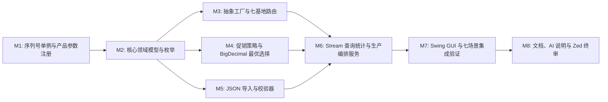

# IMPLEMENTATION_PLAN｜分阶段可执行实施计划

> **状态**：由 Zed 基于真实工程基线定稿，直接移交 ZCode（GLM-5.3-Flash）按顺序执行。
> **自主推进与报审边界**：
> - **ZCode 自主权**：在保持本计划包结构、核心接口契约与业务规则不变的前提下，ZCode 可自主决定辅助类、私有方法签名、Swing 布局细节、异常消息格式及测试用例扩充，无需每步停下请示。
> - **必须重新报 Zed 审查的重大变更**：修改分层依赖方向（如让核心层依赖 Swing）、改动教师既有公开方法签名、更改促销并列优先级或舍入规则、更改七大基地路由映射表。

---

## 模块任务总览与依赖顺序

---

## M1｜序列号单例与产品参数注册（解决基线编译障碍 1）

- **对应评分项**：任务 3（10 分）
- **输入文件**：
  - `src/main/java/com/dji/product/DJIProduct.java`、`ConsumerDrone.java`、`EnterpriseDrone.java`、`AgriculturalDrone.java`、`DJIProductDemo.java`
- **需要新增/修改的代码区域**：
  - 新增 `com.dji.product.SerialNumberGenerator`（线程安全单例，`getInstance()`、`nextSerialNumber()`、包级 `resetForTest(long)`）
  - 新增 `com.dji.product.SerialNumberExhaustedException`
  - 新增 `com.dji.product.DroneSpecRegistry`（封装 `DJIProductDemo` 中 9 个型号的精确构造参数与类别映射）
- **关键验收标准**：
  1. `DJIProductDemo.java` 在**零修改**前提下无编译错误并能正常运行输出 9 架无人机演示信息；
  2. 序列号格式严格为 `DJI-00000001` 至 `DJI-99999999`，超出 `99_999_999` 时立即抛出 `SerialNumberExhaustedException`，不回绕；
  3. 9 个型号（含 `Mini 4 PRO`、`Air 3S`、`Inspire 3` 的 `"禅思  X5S"` 双空格）参数与 `DJIProductDemo` 100% 一致。
- **必须真实运行的测试**：
  - `src/test/java/com/dji/product/SerialNumberGeneratorTest.java`（格式递增、多线程并发 1000 次无重复、`99_999_999` 边界与耗尽异常）
  - `src/test/java/com/dji/product/ProductCreationTest.java`（9 个型号实例化类型与全部属性断言、未知型号异常断言）
- **与下一模块的接口**：
  - `SerialNumberGenerator.getInstance().nextSerialNumber()`
  - `DroneSpecRegistry.createDrone(String productType, String sn)`、`DroneSpecRegistry.isValidModel(String)`

---

## M2｜核心领域模型与枚举（解决基线编译障碍 2，恢复全工程编译）

- **对应评分项**：任务 1（10 分）
- **输入文件**：
  - `src/main/java/com/dji/promotion/DJIPromotion.java`
  - `src/main/resources/order.json`
- **需要新增/修改的代码区域**：
  - 新增 `com.dji.sale` 包下枚举：`Region`、`Currency`、`OrderStatus`、`ProductCategory`、`ProductionBase`
  - 新增 `com.dji.sale` 包下领域类：`Customer`（含 `U+200C` 零宽字符剥离 `normalizedName`）、`OrderItem`、`Order`、`PromotionResult`、`ProductionTask`
  - 新增业务异常：`OrderValidationException`、`ProductionRoutingException`
- **关键验收标准**：
  1. `mvn -B test-compile` 退出码为 `0`（原基线 52 行编译错误彻底清零）；
  2. `Order` 与 `OrderItem` 构造器强制校验非空、数量正整数、单价非负、明细金额 = 单价 × 数量、订单总额 = Σ 明细金额；
  3. `Customer` 保留 `rawName` 并提供去除 `\p{Cf}` 零宽字符的 `normalizedName`。
- **必须真实运行的测试**：
  - `src/test/java/com/dji/sale/DomainModelTest.java`（枚举解析、不可变集合、金额算术不变量校验、`U+200C` 零宽字符清洗）
- **与下一模块的接口**：
  - `com.dji.sale.Order`（直接满足 `DJIPromotion#calculatePromotion(Order)` 签名）

---

## M3｜抽象工厂与七大生产基地路由

- **对应评分项**：任务 4（15 分）
- **输入文件**：
  - `src/main/java/com/dji/factory/DJIFactory.java`
- **需要新增/修改的代码区域**：
  - 在 `com.dji.factory` 包新增 7 个具体工厂子类：`ShenzhenFactory`、`DongguanFactory`、`ShundeFactory`、`NagoyaFactory`、`AmsterdamFactory`、`StuttgartFactory`、`FremontFactory`（可提取公共受保护基类 `AbstractBaseFactory extends DJIFactory` 校验职责范围并调用 `DroneSpecRegistry` + `SerialNumberGenerator`）
  - 新增 `com.dji.factory.ProductionRouter`（唯一集中维护 `Region` × `ProductCategory` → `ProductionBase` / `DJIFactory` 映射）
- **关键验收标准**：
  1. 七个基地职责与任务书表格完全一致（大陆消费→深圳、大陆行业→东莞、全球农业→顺德、亚太消费/行业→名古屋、欧洲消费→阿姆斯特丹、欧洲行业→斯图加特、北南美消费/行业→弗里蒙特）；
  2. 任何基地工厂收到非本基地职责型号或未知型号时抛出 `ProductionRoutingException`（绝不返回 `null`）；
  3. 路由器对未定义组合抛出 `ProductionRoutingException`。
- **必须真实运行的测试**：
  - `src/test/java/com/dji/factory/FactoryRoutingTest.java`（覆盖全部合法地区×类别组合、各工厂越权型号拒绝、未定义路由组合报错、生产流程调用 `orderDrone` 生成唯一序列号）
- **与下一模块的接口**：
  - `ProductionRouter#resolveBase(Region, ProductCategory)`、`ProductionRouter#resolveFactory(Region, ProductCategory)`

---

## M4｜BigDecimal 促销策略模式与最优方案选择

- **对应评分项**：任务 5（15 分）
- **输入文件**：
  - `src/main/java/com/dji/promotion/DJIPromotion.java`
  - `docs/00-基线与输入清单.md` §2.5（`sysgui.png` 14 笔订单期望值表）
- **需要新增/修改的代码区域**：
  - 在 `com.dji.promotion` 新增 `PromotionType`、`PromotionStrategy extends DJIPromotion`
  - 新增 4 个具体策略类：`MainlandFullReductionStrategy`、`MainlandTieredDiscountStrategy`、`OverseasTieredDiscountStrategy`、`NoPromotionStrategy`
  - 新增 `PromotionOptionComparator` 与 `PromotionCalculator`（或 `PromotionService`）
- **关键验收标准**：
  1. 全程使用 `BigDecimal`（`scale=2, RoundingMode.HALF_UP`），零 `float`/`double`；
  2. 大陆满额立减仅当 `region == CHINA_MAINLAND && currency == CNY` 时适用，每满 2000 减 300，无人工档数上限；
  3. 并列优先级严格满足：应付金额最低优先；同价时 **满额立减 > 满件折扣 > 无优惠**；
  4. 真实 `order.json` 全部 14 笔订单的最优方案、优惠额、应付额与 `sysgui.png` 期望表逐笔完全一致。
- **必须真实运行的测试**：
  - `src/test/java/com/dji/promotion/PromotionCalculationTest.java`（14 笔真实订单批量断言、满件 1/2/3/4+ 门槛、满减 0/1/39/100 档无封顶、并列同价满减胜满件、大陆非 CNY 订单禁用满减）
- **与下一模块的接口**：
  - `PromotionCalculator#evaluateBestPromotion(Order)`、`evaluateAllApplicable(Order)`

---

## M5｜JSON 订单文件读取与可定位校验器

- **对应评分项**：任务 2（10 分）
- **输入文件**：
  - `src/main/resources/order.json`
- **需要新增/修改的代码区域**：
  - 新增 `com.dji.repository.OrderValidator`、`JsonOrderRepository`
  - 新增 `com.dji.sale.OrderValidationError`、`OrderLoadResult`
  - 新增测试坏数据 fixture：`src/test/resources/fixtures/invalid_orders.json`（涵盖重复 `orderId`、空字段、未知型号 `Mini 4`、数量 0/负数、负单价、明细金额不等于单价×数量、订单总额不等于明细之和）与 `malformed.json`
- **关键验收标准**：
  1. 加载 `src/main/resources/order.json` 返回 14 笔有效订单、0 条错误；
  2. 加载 `invalid_orders.json` 准确识别每一处错误，每条 `OrderValidationError` 均包含 `orderId`、明细序号（若为明细错误）及原因说明。
- **必须真实运行的测试**：
  - `src/test/java/com/dji/repository/JsonOrderRepositoryTest.java`
- **与下一模块的接口**：
  - `JsonOrderRepository#loadOrders(Path)`

---

## M6｜Stream 查询统计与生产编排服务

- **对应评分项**：任务 7（15 分）+ 任务 4/5/6 服务层支撑
- **输入文件**：M1–M5 产出的领域、工厂、促销、仓储类
- **需要新增/修改的代码区域**：
  - 新增 `com.dji.service.OrderFilter`（`@FunctionalInterface`）、`OrderSearchCriteria`、`OrderQueryService`
  - 新增 `com.dji.service.OrderStatisticsService`、`SystemSummary`（含按币种分组的优惠总额、按基地分组的产品产量、按地区分组的订单数、按型号扁平化汇总的需求量）
  - 新增 `com.dji.service.ProductionService`（单笔生产、全量有效订单生产、重复生产幂等控制）
- **关键验收标准**：
  1. 完整覆盖任务 7 的 6 项要求（多条件 Stream 筛选、`groupingBy`、≥3 种流操作、自定义函数式接口 `OrderFilter`、方法引用/Lambda、`flatMap` 明细扁平化）；
  2. 对 14 笔订单执行全量生产，恰好生成 42 架无人机（`DJI-00000001` ~ `DJI-00000042`），7 个基地产量统计与蓝图 §5.4 完全一致；
  3. 重复对已生产订单触发生产不会重复消耗序列号或翻倍统计产量；
  4. 整个 `com.dji.service` 包零 Swing 依赖。
- **必须真实运行的测试**：
  - `src/test/java/com/dji/service/OrderStreamServiceTest.java`
  - `src/test/java/com/dji/service/ProductionServiceTest.java`
  - `src/test/java/com/dji/ArchitectureDecouplingTest.java`
- **与下一模块的接口**：
  - `OrderQueryService`、`OrderStatisticsService`、`ProductionService`

---

## M7｜Swing 图形交互界面与异步任务

- **对应评分项**：任务 6（20 分）+ 界面验收七场景（G1–G7）
- **输入文件**：M6 全部应用服务、参考截图 `sysgui.png`
- **需要新增/修改的代码区域**：
  - 新增 `com.dji.ui.DJIOrderApp`（系统主入口 `main`，支持 CLI 文件路径参数或默认加载 `order.json`）
  - 新增 `com.dji.ui.MainFrame`、`OrderTableModel`、`OrderItemTableModel`、`ProductionTaskTableModel`
  - 新增后台任务类（基于 `SwingWorker`）处理文件读取与生产模拟
- **关键验收标准**：
  1. 完整实现任务 6 七项界面模块：文件操作（`JFileChooser`）、订单列表表格、组合查询筛选与清除、订单详情展示、生产处理（选中/全部）、汇总面板（成功/失败数、分币种优惠总额、各基地产量）、常驻状态栏反馈；
  2. 监听器仅收集输入、调用 `service` 并刷新 `TableModel`/标签，不内联任何业务规则；
  3. 所有 Swing 组件更新均在 EDT 执行，文件加载与生产通过 `SwingWorker` 异步执行。
- **必须真实运行的测试与验证**：
  - `src/test/java/com/dji/ui/OrderTableModelTest.java`（无头环境验证表格模型数据映射）
  - 在 WSLg 环境下实机运行 `DJIOrderApp`，逐一执行 G1–G7 七个验收场景并记录到 `docs/VERIFICATION.md`

---

## M8｜全量回归、设计说明、AI 使用说明与独立终审

- **对应评分项**：任务 8（5 分）+ 全局 100 分质量门禁
- **需要新增/修改的文件**：
  - 编写设计说明（`README.md` 或 `docs/DESIGN_NOTES.md`）：列出类职责、抽象工厂与策略模式说明、任务 7 六项 Stream/函数式代码精确位置（类名+方法+行号）、Swing EDT/`SwingWorker` 方案、至少 1 个经测试发现并修正的真实问题（如 `0009`/`0010` 客户名 `U+200C` 零宽字符导致搜索失配或促销边界问题）
  - 编写 `docs/AI使用说明.md`：如实记录 Zed、ZCode、ChatGPT 的使用环节与人工验证修改过程
  - 更新 `docs/01-需求追踪矩阵.md`、`docs/PROGRESS.md`、`docs/VERIFICATION.md`、`docs/HANDOFF_FOR_CHATGPT.md`
- **关键验收标准**：
  - `mvn -B clean test` 全部通过（退出码 0），提交 Zed 进行阶段 8 独立审计。
